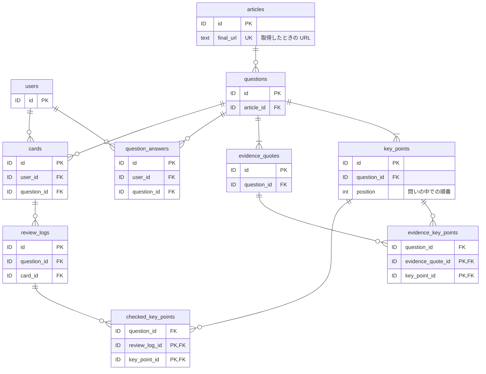

# プロトタイプのデータモデル

- 作成日：2026年11月22日
- 更新：2026年11月23日（レビューを受けて、問いを作れなかった記事の扱いを足し、記録する時点を「終える」を押したときに直した。復習で書いた答えは保存しないと決め、記事から登録した利用者を外した）
- 状態：決定
- 関連：[フェーズ1の範囲](phase1-scope.md)、[ADR 0001](adr/0001-scheduling.md)、[企画メモ 6.3](../portfolio-plan.md)

---

## 1. 保存するもの

### 全員で共有するもの

MVP では、記事とそこから作った問いを全利用者で共有する。

- **記事**：URL を1件登録するごとに1つ。同じ URL を二度登録しても重複させない
  - 中身：入力された URL、取得したときの URL、タイトル、本文、取得日時、本文のハッシュ、問いを作った日時、問いを作れなかった理由
  - 同じ記事かどうかは、入力された URL ではなく取得したときの URL で比べる。S-002 で、登録した URL が別のホストの別の URL に転送される記事があったため（[S-002 の記録](../experiments/s-002-question-trial/README.md)の「本文の取得で分かったこと」）
  - 取得日時と本文のハッシュは、問いがどの時点の本文から作られたかを後から確かめるために持つ。記事が更新されたときの再生成はフェーズ1では作らない
  - 問いを作った日時は、問いをどのプロンプトで作ったかを git の履歴と突き合わせて確かめるために持つ（6章）。1記事の問いは一度にまとめて作るので、問いごとではなく記事に1つ持たせる。取得日時とは別に持つのは、取得のあとで問いの生成が失敗してやり直すと、2つの時刻がずれるため
- **問い**：記事ごとに1回だけ生成する。数は生成したときに記事の中身に合わせて決まり、少なくとも2問
  - 根拠の検証に通った問いが2問に満たない記事は、登録できなかったものとして扱い、問いを1問も保存しない。画面には理由を出す
  - 記事の行は消さずに残し、「問いを作れなかった理由」を持たせる。同じ URL がもう一度登録されたときに、LLM を呼ばずに同じ理由を返すため
  - 理由は2通りある。LLM が最初から問いを作れなかったときは、LLM が返した理由（S-002 のプロンプトの `not_generated`）を入れる。LLM は2問以上返したが根拠の検証で足りなくなったときは、アプリの決まった文を入れる
  - 記事の行は、次の3通りに読める。「問いを作った日時」がない行は、まだ問いを作っていない。日時があって理由がない行は、問いが2問以上ある。日時と理由の両方がある行は、問いを作れなかった記事で、日時は作ろうとした日時を表す
  - 問いを作れなかった記事を、あとから作り直す操作は、フェーズ1では作らない
- **要点**：要点を一つずつ別の記録にする。1問に2〜3個。復習でどの要点を言えたかを要点ごとに残すため
  - 根拠の `supports` は要点を番号（1始まり）で指すので、要点には問いの中での順番を持たせる
- **根拠の引用**：問いに付き、1問に複数ある。引用ごとに、どの要点を支えるかのつながりも残す。1つの引用が複数の要点を支えることも、1つの要点に複数の引用が付くこともあるので、要点と根拠は多対多になる
  - 引用が支える要点は、同じ問いの要点に限る。引用と要点を結び付ける記録にも問いを持たせ、引用と要点がどちらもその問いのものであることをデータベースの制約で確かめる（4章）
  - 復習で言えなかった要点の根拠だけを見せたり、要点に対応する箇所へ飛ばしたり（Issue #1）するため

LLM が返す形は、S-002 の結果（[`results/raw/01.json`](../experiments/s-002-question-trial/results/raw/01.json)）と同じものを想定している。

```
questions[]
  angle         観点（why / condition / compare）
  question      問いの文
  key_points[]  要点（2〜3個）
  evidence[]    根拠（1つの問いに複数）
    quote       本文からの引用
    heading     見出し
    supports[]  この引用がどの要点を支えるか
```

### 人ごとのもの

同じ記事や問いでも、いつ読んだか、次にいつ出るかは人によって違う。共有するものとは分けて持つ。

- **問いを埋めたときの記録**：人と問いの組みごとに1つ。読んだという事実を残すもので、あとから書き換えない
  - 中身：書いた答えの文、要点を見て終えたかどうか、読み終えた日時（下の「終える」を押した日時）
  - 書いた答えは、要点を見る前に書いたものになる。「答えを見る」を押したあとは、答えを直せないため
  - 記事の問いを全部埋め、要点を見て確かめたあと、「終える」を押したときに、その記事の問いの分をまとめて入れる（流れは[フェーズ1の範囲](phase1-scope.md)の「読む前と読みながら」）。「終える」を押す前にやめた記事は何も入れない
  - 1日の記事数の上限を超えた記事も記録する。書いた答えを残し、あとから復習に入れるときに埋め直さなくて済むようにするため
- **go-fsrs の今の状態**（`Card`）：復習に入っている問いだけに、人と問いの組みごとに1つ。復習するたびに、`Next` が返した新しい `Card` で上書きする
  - 中身：出題日、安定度、難しさ、復習した回数、忘れた回数、状態、最後に復習した日時など。加えて、この状態を作った日時（1日の記事数を数えるのに使う）
  - 「終える」を押したときに、その日の記事数が上限に達していなければ、その記事の問いの分をまとめて作る。上限を超えた記事では作らない
  - 状態がある問いが、復習に入っている問いになる。「問いを埋めたときの記録」だけがあって状態がない問いは、読んだが復習には入っていない
  - `NewCard` は出題日をカードを作った時刻にするので、最初の出題日（状態を作った日の翌日）はアプリが決める
  - 上限を超えた記事をあとから復習に入れる操作は、フェーズ1では作らない。作るときは、入れた日の1本として数えて状態を作ればよく、埋め直しは要らない
- **復習の出来事**（`ReviewLog`）：復習するたびに1つ増える。あとから書き換えない
  - 中身：付けた評価、復習した日時、そのときの安定度や難しさなど
  - 「go-fsrs の今の状態」の1行に結び付ける。どの利用者のどの問いの復習かは、状態からたどる
  - チェックを付けた要点が復習した問いの要点であることを制約で確かめるため、問いの ID も持たせる（4章）
- **チェックを付けた要点**：1回の復習の中で、要点ごとにできる
  - 評価の境目を変えたときや、自分専用の重みを学習するときに、評価を出し直せるようにするため（ADR 0001）

### 保存しないもの

- **破棄した問い**：アプリのログに出すだけにする
- **復習のときに書いた答え**：復習では、答えを考えるために要点を書き出せる（任意）が、書いた文は保存しない。過去の復習で書いた答えを、あとから見返すことはないと考えているため
- **読むのにかかった時間**：時計で測って手元の Markdown に書く。検証のための記録で、アプリの機能ではないため
- **設定**（1日の復習数5問、1日の記事数1本、目標の想起確率 0.9、`EnableShortTerm` を false）：プロトタイプではコードに直接書く
- **途中まで埋めた答え**：データベースには保存しない。1本の記事を埋めるのに20分以上かかるので、再読み込みで入力が消えないようにブラウザの側で一時的に持つかどうかは、画面を作るときに決める

## 2. 数え方と判定

- 「今日」は日本時間で決める
- 出題日は日付で比べる。go-fsrs が返す出題日（`Due`）は「評価した時刻 + 日数 × 24時間」の時刻なので、22時に評価した問いの出題日は翌日以降の22時になる。時刻で比べると、その日の朝には出題されない
- go-fsrs に渡す時刻は、日本時間の日付をそのまま UTC の日付にしたものにする（例：日本時間の12月8日なら、何時に復習しても `2026-12-08T12:00:00Z`）。実際に復習した時刻は、復習の出来事に別に残す
  - go-fsrs は前回の復習からの経過日数を UTC の日付の差で数える（v4.0.0 の `dateDiffInDays`）。日本時間の0時から9時は UTC では前日なので、実際の時刻をそのまま渡すと日数がずれる
  - 2026年11月23日に v4.0.0 で確かめた。12月7日10時に Again、12月8日8時に Good を付けると、経過0日として扱われて安定度が 0.212 のまま伸びなかった（10時なら 1.887）。日付をそろえて渡すと、復習した時刻に関係なく 1.887 になった
- 1日の記事数：自分の「go-fsrs の今の状態」のうち、作った日が今日のものを、記事ごとに数える（記事の ID を distinct で数える）
- 今日すでに1本あれば、2本目の記事は読めて問いも埋められる。「問いを埋めたときの記録」は入れるが、「go-fsrs の今の状態」は作らない

## 3. テーブルの一覧

ほかのテーブルとのつながりは、4章の ER 図に書く。カラムの細かい定義（型、NULL を許すか）は、実装するストーリーでマイグレーションを書くときに決める。

| テーブル              | 1章での呼び方              | 1行が表すもの                                      |
| --------------------- | -------------------------- | -------------------------------------------------- |
| `users`               | 利用者                     | 利用者1人                                          |
| `articles`            | 記事                       | 登録した記事1本                                    |
| `questions`           | 問い                       | 記事から作った問い1つ                              |
| `key_points`          | 要点                       | 問いの要点1つ                                      |
| `evidence_quotes`     | 根拠の引用                 | 問いに付いた、本文からの引用1つ                    |
| `evidence_key_points` | 根拠がどの要点に結び付くか | 引用1つが要点1つを支えるという結び付き1つ          |
| `question_answers`    | 問いを埋めたときの記録     | 利用者1人が問い1つを埋めたときの記録               |
| `cards`               | go-fsrs の今の状態         | 利用者1人と問い1つの組みの、今の復習の状態         |
| `review_logs`         | 復習の出来事               | 復習1回                                            |
| `checked_key_points`  | チェックを付けた要点       | 復習1回の中で、言えたとしてチェックを付けた要点1つ |

データベースは PostgreSQL にする（企画メモ 8章と同じ）。テーブル名とカラム名は英語の snake_case にする。

## 4. ER 図

カラムは PK と FK、一意の制約に関わるものだけを書く。ID の型は実装するときに決めるので、図では `ID` と書いている。

記事から問いへの線を「0以上」にしているのは、まだ問いを作っていない記事と、問いを作れなかった記事が、問いのないまま残るため。



一意の制約：

- `articles`：取得したときの URL（`final_url`）で一意
- `key_points`：問いと、問いの中での順番（`question_id`, `position`）の組みで一意
- `question_answers`、`cards`：利用者と問い（`user_id`, `question_id`）の組みで一意
- `evidence_key_points`、`checked_key_points`：2つの FK の組みを PK にするので、同じ結び付きは二重に入らない

別の問いの要点との結び付きを防ぐ制約：

- `evidence_key_points` に問いの ID（`question_id`）を持たせ、2本の複合 FK を張る
  - (`question_id`, `evidence_quote_id`) → `evidence_quotes` (`question_id`, `id`)
  - (`question_id`, `key_point_id`) → `key_points` (`question_id`, `id`)
- `review_logs` と `checked_key_points` にも問いの ID を持たせ、複合 FK を2段で張る
  - (`question_id`, `card_id`) → `cards` (`question_id`, `id`)：復習の出来事の問いが、状態の問いと同じになる
  - (`question_id`, `review_log_id`) → `review_logs` (`question_id`, `id`)
  - (`question_id`, `key_point_id`) → `key_points` (`question_id`, `id`)
- 複合 FK の参照先にするため、`evidence_quotes`、`key_points`、`cards`、`review_logs` には (`question_id`, `id`) の一意の制約も付ける
- これで、引用と要点が別々の問いのものだと、行を入れられなくなる。チェックを付けた要点も、復習した問いの要点でなければ入れられなくなる
- `review_logs` の問いの ID は、状態からたどれる値を重ねて持つことになる。ただ、複合 FK で状態の問いと同じ値しか入らないので、食い違うことはない

## 5. MVP で記事を共有するときの見通し

- 共有するものと人ごとのものを最初から分け、人ごとのテーブルには利用者を持たせている。プロトタイプの利用者は自分の1人だけで、MVP では利用者を増やすだけで済む見込み
- 企画メモ 6.1 では、問いを「学習単位」（資料の取得版と読む範囲の組み）に付ける。プロトタイプでは記事1本を1つの読む範囲とし、問いを記事に直接付けるので、MVP では問いの付け先を記事から学習単位に付け替える必要がある。作り直しがいちばん大きいのはここになる
  - 記事に取得日時と本文のハッシュを持たせているので、今の記事1件は「資料1件と、その最初の取得版1件」に分けて移せる見込み
- 「今日」を日本時間で決め、go-fsrs にも日本時間の日付を渡しているので、利用者ごとのタイムゾーンをどう扱うかを決める必要がある
- 設定をコードに直接書いているので、利用者ごとに変えられるようにするなら、設定を保存する場所が要る

## 6. 検討して選ばなかった持ち方

- **埋めた日と、復習に入ったかどうかを、記事の記録に持たせる**：プロトタイプでは動くが、MVP では記事を全員で共有するので、人によって違う値を持てない
- **今の状態と復習の出来事を、1つの記録にまとめる**：今の状態は1行を上書きし、出来事は1行ずつ増やして書き換えない。1つにまとめると、上書きしたい部分と残しておきたい部分が同じ行に混ざる
- **問いを埋めるたびに、1問ずつ記録する**：途中でやめた記事や、日をまたいで埋めた記事が、その日の1本に数えられてしまう。全部埋めて要点を確かめ、「終える」を押したときに、まとめて入れることにした
- **上限を超えた記事を記録しない**：最初はこの形にしていた。書いた答えが消え、あとから復習に入れるには問いを全部埋め直すことになるので、やめた
- **復習に入ったかどうかを、値で持つ**：復習に入っている問いには「go-fsrs の今の状態」があるので、状態があるかどうかで見分けられる。同じことを表す値を別に持つと、状態と食い違うおそれがある
- **「問いを埋めたときの記録」と「go-fsrs の今の状態」を、1つの記録にまとめる**：どちらも人と問いの組みごとに1つだが、上限を超えた記事の問いには埋めた記録だけがあり、状態がない。まとめると、状態の部分が空の行ができる。埋めた記録は書き換えず、状態は復習のたびに上書きするので、扱いも違う
- **破棄した問いをデータベースに残す**：ログに出すだけにした。破棄した問いは、自分がプロンプトを直すときの材料で、アプリの機能では使わない。MVP でほかの利用者が使うこともなく、試しに使う期間だけ要る情報かもしれないので、ログで足りる
- **問いをどのプロンプトとモデルで作ったかを、別の記録にして残す**：プロンプトは使いながら直すと決めている（[S-002 の評価](../experiments/s-002-question-trial/evaluation.md)の「全体の所見」）ので、直す前と後の問いを見分ける手段は要る。ただ、フェーズ1では問いを記事ごとに1回だけ作り、プロンプトとモデルの指定はコードにあって git に履歴が残る。記事に持たせた「問いを作った日時」と git の履歴を突き合わせれば見分けられるので、別の記録は持たない。プロンプトを直したら、すぐにコミットする
  - MVP で、古いプロンプトで作った問いだけを作り直すようになったら、データベースの中で版を見分けたくなる。そのときに足す
- **根拠の引用を、要点にだけ結び付ける**：どの引用も少なくとも1つの要点を支えるなら、要点を通して問いまでたどれる。ただ、1つの引用が別々の問いの要点に結び付くと、どの問いの根拠かが決まらなくなる。引用にも問いを持たせ、引用と要点が同じ問いのものであることを確かめられるようにした。LLM が問いの下に根拠を返す形とも合う
  - 確かめ方は、アプリで保存するときに確かめる形ではなく、結び付きの記録に問いを持たせて複合 FK で縛る形にした。アプリで確かめる形は、確かめ忘れると防げないため
- **復習の出来事を、利用者と問いの組みに直接結び付ける**：状態を消したり作り直したりしても出来事が残る利点はある。ただ、出来事を使う場面（復習で評価を付ける、評価を出し直す、自分専用の重みを学習する）を考えると、状態を介して使うことが多いので、状態の1行に結び付けた。フェーズ1には状態を消す操作がない。MVP で問いを復習から外す操作を作るときは、状態を消さずに、外したことを示す印を付ける
- **記事に、登録した利用者を持たせる**：フェーズ2で記事を登録できる利用者を制限するときに要ると考えて、一度は持たせた。ただ、制限に要るのは「この利用者は登録してよいか」という利用者の側の情報で、記事に登録した人を持たせても制限はできない。同じ記事は重複させないので、残るのも最初に登録した1人だけになる。使い道が決まっていないので外した。フェーズ2で制限の仕組みを決めるときに、要るかどうかを考える
- **フェーズ1では SQLite を使う**：自分だけがローカルで使うなら手軽だが、MVP で PostgreSQL に移すときにデータベースを作り直すことになる。作り直しを避けるため、最初から PostgreSQL にした
